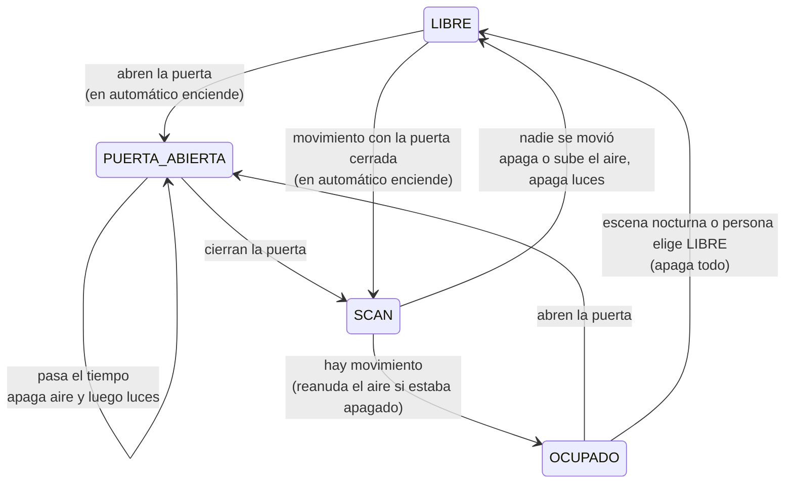

# Aula inteligente – Puerta, movimiento y horario

Blueprint de automatización de Home Assistant para **salones de clase con sensor de puerta y sensor de movimiento**. Controla el aire acondicionado y las luces según la puerta, el movimiento, el horario escolar y los días hábiles.

Archivo: `aula_puerta_horario.yaml` · Autor: NovaEnergyCo · Requiere Home Assistant 2024.10 o superior.

---

## La idea en una frase

**La puerta manda y el movimiento confirma.** Si la puerta queda abierta, el salón se apaga para que el aire frío no se escape. Si la puerta está cerrada, el sensor de movimiento decide si todavía hay gente.

Esto ahorra energía y además **educa**: los estudiantes aprenden que el aire solo funciona con la puerta cerrada.

---

## ¿Cuándo usarlo?

| Situación | ¿Este blueprint? |
|---|---|
| Salón con sensor de puerta y sensor de movimiento | ✅ Sí |
| Aire por termostato (`climate`) | ✅ Sí |
| Aire por contactor (switch del control de carga CC) | ✅ Sí |
| Termostato **y** contactor en el mismo salón | ✅ Sí |
| Salón solo con aire, o solo con luces | ✅ Sí (las dos cosas son opcionales) |
| Jornada con hora de inicio, hora de fin y días hábiles | ✅ Sí |
| Espacio **sin** sensor de puerta (pasillos, comedor, biblioteca abierta) | ❌ Usa `espacio_movimiento_horario.yaml` |
| Espacio donde la puerta abierta es normal (oficina con atención al público) | ❌ La regla de puerta apagaría el aire; usa `espacio_movimiento_horario.yaml` |

---

## Cómo funciona

El salón siempre está en uno de cuatro estados (ayudante `input_select`):

| Estado | Qué significa |
|---|---|
| **LIBRE** | No hay nadie. Aire apagado (o en temperatura de no ocupación) y luces apagadas. |
| **PUERTA_ABIERTA** | La puerta está abierta. Corre la cuenta de puerta abierta; al terminar, el aire y las luces se apagan. |
| **SCAN** | La puerta se acaba de cerrar. El blueprint observa el movimiento para saber si quedó gente. |
| **OCUPADO** | Hay gente con la puerta cerrada. Todo encendido. |

### Paso a paso

1. **Llegan y abren la puerta.** Si el salón estaba LIBRE y es horario de clase, se encienden las luces y el aire a la temperatura de ocupación.
2. **Cierran la puerta.** Empieza el SCAN. Basta con que alguien se mueva para confirmar OCUPADO al instante.
3. **Dejan la puerta abierta.** Tras el tiempo configurado (5 min por defecto) se apaga el aire y, un minuto después, las luces. **No importa si hay movimiento**: el salón queda así hasta que cierren la puerta.
4. **Vuelven a cerrar la puerta con gente adentro.** Con el primer movimiento se reanudan el aire y las luces.
5. **Salen todos y cierran la puerta.** Si nadie se mueve durante el SCAN, el salón pasa a LIBRE: el aire se apaga (o sube a la temperatura de no ocupación) y luego se apagan las luces.
6. **Salen y dejan la puerta abierta.** La cuenta de puerta abierta apaga todo.
7. **Fin de la jornada.** El modo pasa a manual. Si el salón no está ocupado, se apaga todo. Si todavía hay clase, se apagará cuando se vayan.
8. **De noche.** La escena nocturna pone el salón en LIBRE y el blueprint apaga todo.

### Modo automático y modo manual

- **Automático** (dentro del horario y en día hábil): enciende y apaga.
- **Manual** (fuera del horario): **nunca enciende, solo apaga.** Si alguien prende el aire a mano y se va, el blueprint lo apaga igual.

---

## Herramientas que incluye

| Herramienta | Para qué sirve |
|---|---|
| **Regla de puerta abierta** | Apaga el aire y luego las luces si la puerta queda abierta, haya o no movimiento. |
| **SCAN robusto** | Confirma la ocupación con cualquier movimiento nuevo **o** si el sensor sigue encendido al terminar. Funciona con sensores de tiempo corto y largo. |
| **Reanudación al cerrar** | Si la puerta apagó el aire y la cierran con gente, el aire vuelve con el primer movimiento. Si se fueron todos, no se enciende. |
| **Respeta las luces del profesor** | Confirmar ocupación no vuelve a prender luces que el profesor apagó (por ejemplo, para proyectar). |
| **Entrada sin evento de puerta** | Si hay movimiento con el salón LIBRE y la puerta cerrada, enciende y confirma con el SCAN. |
| **Horario y días hábiles** | Hora de inicio y de fin. Con el sensor Workday solo arranca en días hábiles (festivos y fines de semana quedan en manual). |
| **Al quedar libre: apagar o subir** | Dentro del horario se puede apagar el aire o subirlo a una temperatura de no ocupación, para que el salón no se caliente entre clases. |
| **Aire por termostato y/o contactor** | Maneja termostatos `climate` y contactores (switch del CC). El contactor no regula temperatura: en "subir" se apaga. |
| **Apagado escalonado** | Primero el aire y después las luces, con una espera configurable. |
| **Protección por tiempo máximo** | Si queda OCUPADO sin ningún movimiento durante el tiempo máximo (60 min por defecto), apaga. 0 = desactivada. |
| **LIBRE manual o por escena** | Una persona o una escena (por ejemplo, la nocturna) pueden forzar LIBRE y el blueprint apaga todo. |
| **Recuperación tras reinicio** | Si Home Assistant se reinicia a mitad de una cuenta, la retoma en vez de dejar equipos encendidos. |
| **Cuenta regresiva visible** (opcional) | Muestra en el tablero los segundos que faltan de la cuenta de puerta abierta o del SCAN. |
| **Estado anterior visible** (opcional) | Muestra el estado anterior del salón, útil para diagnóstico. |

---

## Lo que necesitas antes de instalarlo

Créalos antes, uno por espacio, en Ajustes → Dispositivos y servicios → Ayudantes:

| Ayudante | Tipo | Obligatorio | Detalle |
|---|---|---|---|
| ESTADO … | Desplegable (`input_select`) | Sí | Opciones exactas: `LIBRE`, `OCUPADO`, `PUERTA_ABIERTA`, `SCAN`. |
| AUTO … | Interruptor (`input_boolean`) | Sí | Modo automático. Lo manejan el horario y las escenas. |
| TIMER … | Número (`input_number`) | No | Cuenta regresiva. Mínimo 0, **máximo 1800**, paso 1. |
| STATUS … | Texto (`input_text`) | No | Muestra el estado anterior. |
| Dias Operativos | `binary_sensor` de Workday | No | Vacío = todos los días son hábiles. |

> ⚠️ **El TIMER debe aceptar al menos 1800.** El blueprint escribe ahí los segundos de la cuenta regresiva (por ejemplo, 420 del scan). Con un máximo de 100, Home Assistant rechaza el valor, la automatización se detiene y el salón queda trabado sin apagar.

En los campos de luces, termostatos y contactores selecciona **entidades**, no áreas ni dispositivos. El blueprint revisa qué equipos hay a partir de las entidades elegidas.

---

## Configuración

| Campo | Por defecto | Recomendación |
|---|---|---|
| Sensor de puerta | — | `binary_sensor` de tipo puerta. |
| Sensores de movimiento | — | Uno o varios. Pueden ser `binary_sensor` o `switch` (contacto seco CS del sensor de 110 V). |
| Iluminación | vacío | Opcional. |
| Termostatos | vacío | Opcional. |
| Aire por contactor | vacío | Opcional. |
| Hora de inicio / fin | 06:00 / 14:00 | Según la jornada del colegio. |
| Al quedar libre | Apagar el aire | Con contactor siempre se apaga. |
| Temperatura de ocupación | 23 °C | |
| Temperatura de no ocupación | 27 °C | Solo con "Subir". |
| **Tiempo de Scan** | **420 s** | **Debe ser mayor que el tiempo que el sensor de movimiento se queda encendido.** Ver abajo. |
| Tiempo con la puerta abierta | 300 s | Cuánto se tolera la puerta abierta antes de apagar. |
| Tiempo máximo ocupado sin movimiento | 60 min | 0 desactiva la protección. |
| Espera entre el aire y las luces | 60 s | |

### El ajuste más importante: Tiempo de Scan contra el sensor

Al cerrar la puerta, el sensor puede seguir encendido por la persona que acaba de salir. Si el sensor dura más que el SCAN, el blueprint lo toma como gente adentro y el salón queda OCUPADO vacío hasta la escena nocturna.

**Regla:** Tiempo de Scan > tiempo de encendido del sensor. Con el SCAN por defecto (420 s), ajusta el sensor (la perilla de tiempo del CS) a **4 minutos o menos**. Un sensor de 30 s a 2 min da los mejores resultados.

---

## ¿Por qué usar esta versión?

Esta versión reemplaza a `edu_control.yaml` ("Aula inteligente - Multi dispositivos") y a la primera versión de este blueprint. Las tres se probaron con un simulador que reproduce paso a paso su lógica en los mismos escenarios de salón.

### Resultados

| Escenario | edu_control | Versión 1 | **Esta versión** |
|---|---|---|---|
| Clase normal | Acierta solo por suerte | ✅ | ✅ |
| Examen (poco movimiento) | ❌ Apaga el aire con gente | ✅ | ✅ |
| Puerta abierta durante la clase | ✅ Apaga | ❌ Nunca apaga | ✅ Apaga |
| La cierran con gente después de apagar | Reenciende al cerrar, haya o no gente | — | ✅ Vuelve con el primer movimiento |
| Salen y dejan la puerta abierta | ✅ Apaga | ❌ Queda encendido | ✅ Apaga |
| Sensor que se queda encendido (clase activa) | ✅ | ❌ 40 min sin aire con gente | ✅ |
| Escena nocturna pone LIBRE | ✅ | ❌ La descarta | ✅ Apaga todo |
| Reinicio de Home Assistant a mitad de una cuenta | ❌ Equipos encendidos | ❌ Equipos encendidos | ✅ Retoma |
| Aire por contactor (CC) | ❌ No lo soporta | ✅ | ✅ |
| Horario y días hábiles | ❌ No tiene | ✅ | ✅ |
| Funciona sin termostatos | ❌ Probablemente falla | ✅ | ✅ |

**Probabilidad de apagar el aire con gente en una clase con la puerta cerrada**, según el ritmo de movimiento y el tipo de sensor:

| Movimiento cada / sensor encendido | edu_control | Versión 1 | **Esta versión** |
|---|---|---|---|
| 60 s / 30 s | 50 % | 0 % | **0 %** |
| 120 s / 30 s | 75 % | 0 % | **0 %** |
| 240 s / 30 s | 88 % | 0 % | **0 %** |
| 60 s / 120 s | 0 % | 100 % | **0 %** |
| 240 s / 120 s | 50 % | 19 % | **0 %** |
| 300 s / 240 s | 20 % | 75 % | **20 %** |

Esta versión se midió con su SCAN por defecto (420 s) y las otras dos con 300 s.

### Por qué falla cada versión anterior

- **edu_control** mira el sensor **en un solo segundo**, al final del SCAN. Si en ese instante nadie se está moviendo, decide que el salón está vacío y apaga el aire, aunque haya una clase entera sentada.
- **La versión 1** espera un **nuevo** encendido del sensor. Si el sensor ya estaba encendido y sigue así, nunca ve el cambio y apaga con la clase adentro. Además, con la puerta abierta mantenía todo encendido si veía movimiento, en contra de la regla de puerta.
- **Esta versión** combina las dos señales (movimiento nuevo **o** sensor encendido al final) y aplica la regla de puerta sin excepciones.

---

## Escenas recomendadas

- **Horario:** el propio blueprint pasa el modo a automático a la hora de inicio y a manual a la hora de fin. No hace falta otra escena para eso.
- **Escena nocturna:** pone todos los salones en LIBRE. El blueprint apaga lo que haya quedado encendido y deja el estado listo para el día siguiente.
- **MASTER OFF AC / LUCES:** se recomienda mantenerlos como respaldo a la hora configurada en cada controlador.

---

## Limitaciones conocidas

- **Visitas cortas en automático encienden el salón.** Un conserje que abre la puerta un minuto en horario de clase deja el aire unos 7 min y las luces unos 8 min (SCAN de 420 s y 60 s de espera entre aire y luces). Fuera del horario no enciende.
- **Clases casi inmóviles.** Con movimiento cada 5 min o más y un sensor de 4 min, en uno de cada cinco casos el salón puede pasar a LIBRE. En cuanto alguien se mueva con la puerta cerrada, vuelve a encender.
- **Sensor mal ajustado.** Si el sensor dura más que el SCAN, el salón puede quedar OCUPADO vacío hasta la escena nocturna (ver "El ajuste más importante").
- **Selección por área o dispositivo.** En luces, termostatos y contactores hay que elegir entidades.
- **Pendiente de verificar en un salón real:** que el LIBRE que pone el propio blueprint no se confunda con un LIBRE manual o de escena. En el simulador funciona; falta confirmarlo en Home Assistant.
